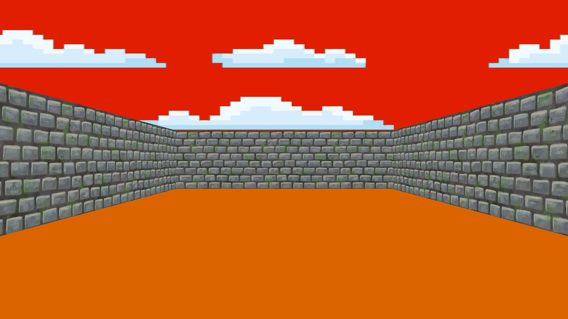

# cub3D

A 42 Amman team project: a first-person 3D maze in the style of Wolfenstein 3D, drawn with raycasting in C. It reads a map from a `.cub` file and lets you walk around inside it with textured walls.



## How it works

For every column of the screen, the program casts one ray from the player into the map and steps through the grid with the DDA algorithm until the ray hits a wall. The distance to that wall sets how tall the wall slice is drawn, and the exact hit point picks which column of the wall texture to use. The floor and ceiling are flat colors, and clouds scroll across the ceiling as you turn.

Graphics, windows and input use [MLX42](https://github.com/codam-coding-college/MLX42), which is included in the repo.

## Build and run

You need `cc`, `make`, `cmake` and GLFW (on Debian or Ubuntu: `sudo apt install build-essential cmake libglfw3-dev`).

```sh
make
./cub3D maps/good/subject_map.cub
```

Run it from the repo folder, because texture paths in the maps are relative to it.

| Key | Action |
| --- | --- |
| `W` `A` `S` `D` | move forward, left, back, right |
| `←` `→` or the mouse | turn |
| `Shift` | run |
| hold `Ctrl` | show the mouse cursor |
| `Esc` or close the window | quit |

You slide along walls instead of stopping dead when you walk into them at an angle.

## The `.cub` map file

```
NO textures/wall.png
SO textures/wall.png
WE textures/wall.png
EA textures/wall.png

F 220,100,0
C 225,30,0

        1111111111111111111111111
        1000000000110000000000001
        1011000001110000000000001
        1001000000000000000000001
111111111011000001110000000000001
100000000011000001110111111111111
11110111111111011100000010001
11110111111111011101010010001
11000000110101011100000010001
10000000000000001100000010001
10000000000000001101010010001
11000001110101011111011110N0111
11110111 1110101 101111010001
11111111 1111111 111111111111
```

- `NO` `SO` `WE` `EA`: the PNG texture for walls facing north, south, west and east.
- `F` and `C`: floor and ceiling colors as `R,G,B`, each from 0 to 255.
- The map comes last: `1` is a wall, `0` is floor, spaces are empty, and one of `N` `S` `E` `W` is the player's start position and facing direction.

The settings can come in any order, but each must appear exactly once. The map must be closed by walls on every side, and there must be exactly one player. Anything wrong makes the program print `Error` and the reason on the next line, then exit with status 1.

`maps/good/` has maps that should run, and `maps/bad/` has one broken map per kind of error.

## Files

| Path | Contents |
| --- | --- |
| `src/main.c` | argument and file-name checks, start-up |
| `src/parsing/` | reading and validating the `.cub` file: textures, colors, map, walls, player |
| `src/init/` | setting up the game state and the player's position and direction |
| `src/run_game/` | the game loop: raycasting (`dda.c`), drawing (`render.c`, `walls.c`), movement and collisions, mouse |
| `src/end/` | error messages and freeing everything |
| `libft/` | our C library |
| `MLX42/` | the graphics library |

## Authors

A team project by [thaqer](https://github.com/thaqer) (tbaniatt) and [daniahqaddomi](https://github.com/daniahqaddomi) (dqaddomi), 42 Amman.
